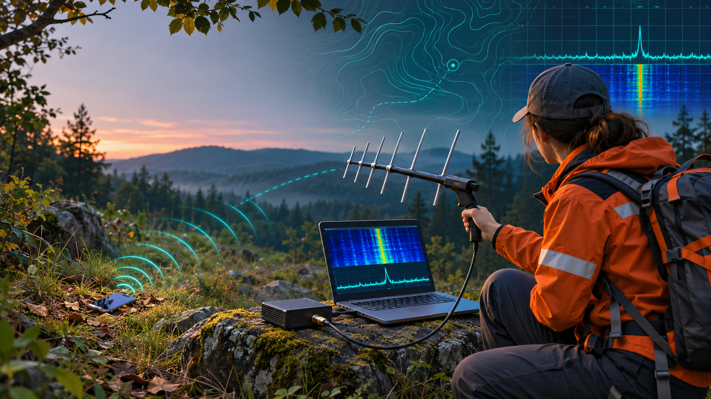
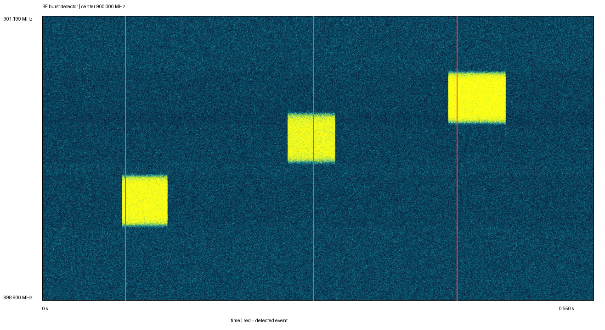

# Phone RF Locator

> Open research concept: can a receive-only SDR detect radio bursts from a lost phone often enough to help narrow a civilian search-and-rescue area?

[Русская версия](README_RU.md)



## Project status

**Research concept and synthetic signal-processing PoC. Not a working phone locator.**

The repository currently contains a reproducible burst detector for synthetic I/Q recordings, a plain-language concept description, an engineering plan, a bench-test protocol and a hardware shortlist. No real-phone RF measurements, direction finding, range claims or airborne tests have been validated yet.

## Why this is public

The author does not currently have enough time, budget or engineering resources to take the concept to a field-ready prototype. The idea and the first PoC materials are therefore published openly in the hope that someone can test, improve or independently implement them.

If the concept seems useful, please share this repository with RF engineers, radio amateurs, DSP developers and civilian search-and-rescue communities.

## The idea

A missing person may still carry a powered-on phone even when normal cellular coverage and operator-provided location data are unavailable. The proposal is to use an SDR in **receive-only mode** to observe selected cellular, Wi-Fi and Bluetooth frequency windows and detect short RF bursts above the local noise floor.

The intended chain is:

```text
phone transmission
      -> receive-only SDR
      -> spectrogram and adaptive noise estimate
      -> anonymous burst events
      -> later: bearing estimates from several positions
      -> probable search area for a rescue team
```

The system is not intended to decode payloads, extract subscriber identifiers or identify the phone owner.

## The critical unknown

The concept only works while a phone is actually transmitting. A phone without service may remain radio-silent for long and unpredictable periods, and unrelated emitters may look similar to an energy-only detector. Therefore the first objective is not drone integration or precise geolocation. It is a controlled **Go/No-Go bench experiment**:

1. Record the same frequency windows with an empty setup, a powered-off phone, booting, normal service and no-service conditions.
2. Repeat the test with several phone models and modem families.
3. Measure burst count, excess power over noise, occupied bandwidth and the longest silent interval.
4. Continue only if repeatable transmissions are detectable often enough for a practical search pattern.

If this condition fails, the honest conclusion is that a universal passive locator is not viable. A cooperative phone application or a dedicated rescue beacon would be a more realistic direction.

## What already works

The included Python package can:

- generate a synthetic complex-I/Q capture;
- compute a short-time spectrum;
- estimate an adaptive noise floor;
- detect burst-like events;
- export JSON and CSV event lists;
- render a spectrogram.

All three included unit tests pass. The detector has not yet been validated against a real SDR recording.



## Quick start

Python 3.11 or newer is required.

```bash
python -m venv .venv
# Windows: .venv\Scripts\activate
# Linux/macOS: source .venv/bin/activate
python -m pip install --upgrade pip
python -m pip install -e .
python -m rf_poc.cli demo demo-output
python -m unittest discover -s tests -v
```

To process a compatible recording:

```bash
python -m rf_poc.cli detect capture.npz --output-dir results
```

The NPZ file must contain `iq`, `sample_rate_hz` and `center_frequency_hz`.

## Proposed low-cost Stage 0

- one original ADALM-Pluto or a comparable SDR used only as a receiver;
- passive receiving antenna(s) for the selected test bands;
- laptop instead of an embedded computer;
- RF-shielded test enclosure;
- owned phones used in controlled scenarios;
- 50-ohm termination on the unused transmitter port.

One ADALM-Pluto channel can detect energy but cannot estimate angle of arrival. Direction finding, coherent multi-channel receivers and an airborne payload belong to later stages and only make sense after a positive bench result.

## Safety, privacy and legal boundaries

- Test only devices owned by the experimenter or used with explicit consent.
- Keep the SDR receive-only; the repository contains no transmit code.
- Do not demodulate traffic or extract IMSI, IMEI, MAC addresses, message content or other identifiers.
- Do not jam, spoof or emulate a cellular base station.
- Do not use the concept to track people without consent.
- Check local spectrum, privacy, equipment-import and aviation requirements before any field or flight test.

Passive reception is **not automatically legal in every jurisdiction**. Compliance depends on what is received, processed, stored and how the equipment and aircraft are operated.

See the [plain-language concept description](docs/IDEA_RU.md), [Ethics and safety](docs/ETHICS_AND_SAFETY.md) and [Claims and limitations](docs/CLAIMS_AND_LIMITATIONS_RU.md).

## Background

According to the project author, the concept was discussed with representatives of the LizaAlert search-and-rescue community, including its UAV direction, and there was interest in testing a prototype. This statement is not presented as a formal partnership, endorsement or validated field result.

## Repository map

- `rf_poc/` - synthetic I/Q generator, burst detector and CLI;
- `tests/` - unit tests;
- `docs/IDEA_RU.md` - plain-language description of the idea in Russian;
- `docs/ENGINEERING_PLAN_RU.md` - staged engineering plan in Russian;
- `docs/TEST_PROTOCOL_RU.md` - controlled test protocol in Russian;
- `docs/BOM_RU.md` - dated purchasing snapshot and hardware notes;
- `docs/CLAIMS_AND_LIMITATIONS_RU.md` - what remains unproven;
- `docs/EXPERIMENT_REPORT_TEMPLATE.md` - reusable measurement report;
- `demo/` - example detector output.

The README and the limitations document define the current evidence level. Numerical range, accuracy and coverage estimates from early project discussions are not treated as validated specifications.

## If you implement it

Fork the repository, document the exact hardware and phone state, publish raw or privacy-safe derived measurements, and report negative results as carefully as positive ones. A reproducible No-Go result would be valuable engineering evidence.

No attribution beyond the applicable repository licenses is required, but a link back helps others find prior measurements.

## Licensing

The Python source code and tests are available under the MIT License. Original text documentation is available under CC BY 4.0. Third-party visual assets, if any are added later, are excluded from those grants. See [LICENSE](LICENSE).

