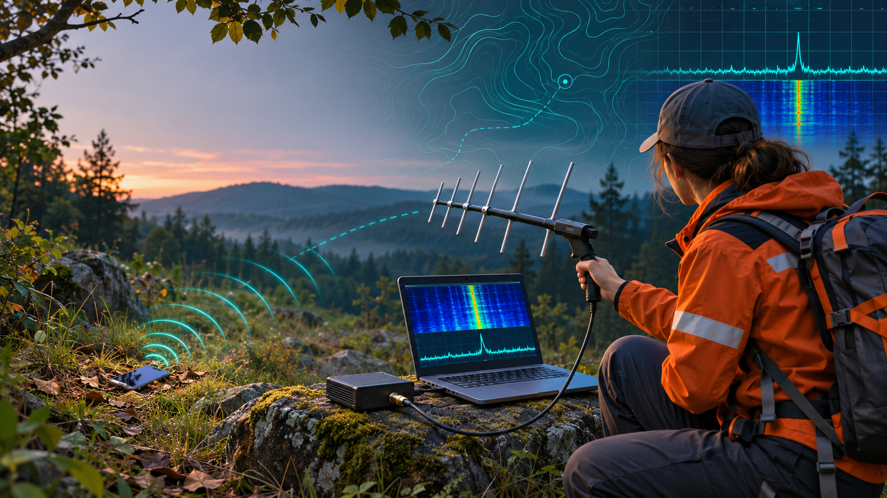
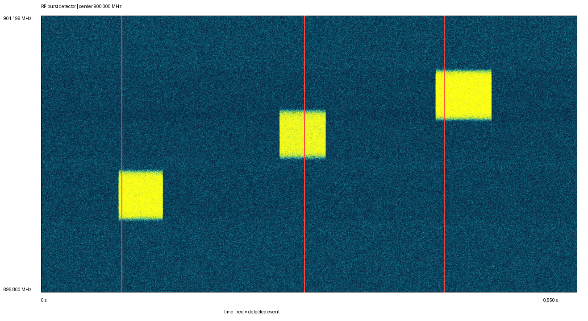

# Phone RF Locator

> Открытая исследовательская идея: можно ли пассивно обнаруживать радиопередачи потерянного телефона и использовать их для сужения района гражданского поиска?

[English version](README.md)



## Текущий статус

**Исследовательская концепция и синтетический программный PoC. Это пока не рабочий локатор телефона.**

В репозитории есть понятное описание идеи, воспроизводимый детектор импульсов для синтетических I/Q-записей, инженерный план, протокол лабораторного эксперимента и перечень оборудования. Реальные измерения телефонов, дальность обнаружения, пеленгация, точность координат и испытания с воздуха пока не подтверждены.

## Почему идея опубликована открыто

Сейчас у автора не хватает времени, бюджета и инженерных ресурсов, чтобы самостоятельно довести идею до полевого прототипа. Поэтому концепция и первые материалы публикуются открыто - в надежде, что кто-то сможет проверить гипотезу, улучшить подход или самостоятельно реализовать систему.

Если идея кажется полезной, пожалуйста, покажите этот репозиторий инженерам по радиосвязи, радиолюбителям, DSP-разработчикам и участникам гражданских поисково-спасательных сообществ.

## Суть идеи

У пропавшего человека может оставаться включённый телефон даже там, где нет нормального покрытия и недоступны координаты от оператора. Предлагается использовать SDR **только в режиме приёма**, последовательно наблюдать выбранные сотовые, Wi-Fi и Bluetooth диапазоны и фиксировать короткие радиоимпульсы выше локального шумового фона.

Предполагаемая цепочка:

```text
передача телефона
      -> пассивный SDR-приёмник
      -> спектрограмма и адаптивная оценка шума
      -> анонимные радиоимпульсы
      -> позднее: пеленги из нескольких точек
      -> вероятная зона для проверки поисковой группой
```

Система не должна декодировать содержимое трафика, извлекать идентификаторы абонента или устанавливать личность владельца телефона.

## Главный неизвестный фактор

Пассивный приём работает только тогда, когда телефон действительно передаёт. Устройство вне сети может долго и непредсказуемо молчать, а другие источники способны выглядеть похоже для простого энергетического детектора.

Поэтому первый этап - не дрон и не точная геолокация, а контролируемый **Go/No-Go эксперимент**:

1. Записать одинаковые частотные окна для пустого стенда, выключенного телефона, загрузки, нормальной сети и режима без сети.
2. Повторить опыт с несколькими моделями и разными модемами.
3. Измерить количество импульсов, превышение над шумом, занимаемую полосу и максимальный интервал радиомолчания.
4. Продолжать только в том случае, если передачи повторяемо обнаруживаются достаточно часто для практического поискового маршрута.

Если условие не выполняется, честный вывод будет таким: универсальный пассивный локатор неработоспособен. Тогда реалистичнее добровольное приложение или отдельный спасательный маяк.

## Что уже работает

Приложенный Python-пакет умеет:

- генерировать синтетическую комплексную I/Q-запись;
- строить кратковременный спектр;
- оценивать адаптивный шумовой фон;
- выделять импульсные события;
- выгружать JSON и CSV;
- строить спектрограмму.

Все три теста проходят. На реальных SDR-записях алгоритм пока не проверялся.



## Быстрый запуск

Нужен Python 3.11 или новее.

```powershell
py -3.11 -m venv .venv
.\.venv\Scripts\Activate.ps1
python -m pip install --upgrade pip
python -m pip install -e .
python -m rf_poc.cli demo demo-output
python -m unittest discover -s tests -v
```

Обработка совместимой записи:

```powershell
python -m rf_poc.cli detect capture.npz --output-dir results
```

NPZ-файл должен содержать `iq`, `sample_rate_hz` и `center_frequency_hz`.

## Бюджетный этап 0

- один оригинальный ADALM-Pluto или сопоставимый SDR, используемый только как приёмник;
- пассивная приёмная антенна или несколько антенн под выбранные диапазоны;
- обычный ноутбук вместо отдельного мини-компьютера;
- экранированный контейнер для контролируемых сценариев;
- собственные телефоны участников эксперимента;
- 50-омная нагрузка на неиспользуемом передающем выходе.

Один канал ADALM-Pluto способен обнаруживать энергию, но не определять направление прихода. Пеленг, когерентный многоканальный приёмник и воздушный носитель относятся к следующим этапам и имеют смысл только после положительного лабораторного результата.

## Безопасность, приватность и право

- Использовать только собственные устройства или устройства участников, давших явное согласие.
- Оставлять SDR только в режиме приёма; передающего кода в репозитории нет.
- Не демодулировать трафик и не извлекать IMSI, IMEI, MAC-адреса, содержимое сообщений или другие идентификаторы.
- Не применять помехи, спуфинг и имитацию базовой станции.
- Не использовать концепцию для слежения за людьми без согласия.
- До полевых или полётных испытаний проверить местные требования к радиоприёму, приватности, ввозу оборудования и эксплуатации БПЛА.

Пассивный приём **не становится автоматически законным во всех странах**. Правовая оценка зависит от того, какие сигналы принимаются, как они обрабатываются и хранятся, а также от правил использования оборудования и воздушного пространства.

См. [Описание идеи](docs/IDEA_RU.md), [Этика и безопасность](docs/ETHICS_AND_SAFETY.md) и [Проверка утверждений и ограничения](docs/CLAIMS_AND_LIMITATIONS_RU.md).

## Предыстория

По словам автора проекта, идея обсуждалась с представителями поисково-спасательного сообщества «ЛизаАлерт», включая направление БПЛА, и вызвала интерес к тестированию прототипа. Это не следует считать официальным партнёрством, публичным одобрением проекта или подтверждённым результатом испытаний.

## Что находится в репозитории

- `rf_poc/` - генератор синтетических I/Q-данных, детектор и CLI;
- `tests/` - автоматические тесты;
- `docs/IDEA_RU.md` - простое описание идеи;
- `docs/ENGINEERING_PLAN_RU.md` - поэтапный инженерный план;
- `docs/TEST_PROTOCOL_RU.md` - контролируемый протокол испытаний;
- `docs/BOM_RU.md` - московская спецификация и цены в рублях;
- `docs/BOM_EN.md` - европейская спецификация на английском с ценами в евро и долларах;
- `docs/CLAIMS_AND_LIMITATIONS_RU.md` - перечень неподтверждённых утверждений;
- `docs/EXPERIMENT_REPORT_TEMPLATE.md` - шаблон отчёта об измерениях;
- `demo/` - пример результата детектора.

Текущий уровень доказательности определяют этот README и документ с ограничениями. Ранние оценки дальности, точности и производительности не считаются подтверждёнными характеристиками.

## Если вы решите реализовать идею

Сделайте форк, зафиксируйте точную конфигурацию оборудования и состояние телефона, публикуйте сырые либо безопасно обезличенные измерения и одинаково внимательно описывайте положительные и отрицательные результаты. Воспроизводимый результат No-Go будет не менее ценен, чем успешный прототип.

Обязательной атрибуции сверх условий лицензий нет, но ссылка на исходный репозиторий поможет другим найти предыдущие измерения.

## Лицензирование

Исходный Python-код и тесты доступны по лицензии MIT. Оригинальные текстовые документы - по CC BY 4.0. Сторонние визуальные материалы, если они будут добавлены позднее, исключены из этих разрешений. Подробнее: [LICENSE](LICENSE).

